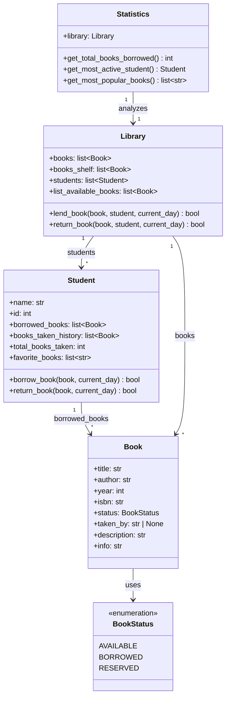

# ООП-проєкт: система управління бібліотекою
> Це підсумкова робота з ООП: ви проєктуєте кілька взаємодіючих класів, описуєте їх діаграмою UML, розбиваєте програму на модулі, запускаєте симуляцію та перевіряєте її тестами. Робочий приклад: [example/library](../../example/library).

## Мета роботи
Навчитись проєктувати програму з кількох класів (композиція та взаємодія об'єктів), використовувати `Enum`, `property`, змінні класу, будувати UML-діаграму класів у Markdown (`mermaid`) і покривати логіку тестами.

## Що потрібно знати / підготувати
- виконані роботи [«Знайомство з ООП»](../05_OOP_first_class/README.md), [«Робота з класами»](../05_OOP_work_with_classes/README.md) та [«Парадигми ООП»](../05_OOP_paradigms/README.md);
- базові відомості про `pytest` (див. [02_pytest](../07_testing/02_pytest/README.md)) — тести можна додати після виконання цієї роботи або разом із нею;
- Python 3.13+ та `pytest` (`pip install pytest`);

---
## Постановка задачі
Студенти коледжу беруть книги в бібліотеці та повертають їх. Потрібно змоделювати це та зібрати статистику.

| Клас | Відповідальність |
| --- | --- |
| `BookStatus` (`Enum`) | можливі статуси книги: `в наявності`, `взята`, `зарезервована` |
| `Book` | назва, автор, рік, ISBN, статус, хто взяв |
| `Student` | ім'я, унікальний ID, взяті книги, історія, дні читання |
| `Library` | каталог, полиця, зареєстровані студенти; видача та повернення книг |
| `Statistics` | підсумки: усього видач, найактивніший студент, найпопулярніші книги |

### UML-діаграма класів
GitHub відображає діаграми `mermaid` прямо у Markdown. Скопіюйте діаграму у свій `README.md` і оновлюйте її разом з кодом:



---
## Хід роботи

### 1. Знайомство з прикладом
1. Скопіюйте папку [example/library](../../example/library) у папку своєї роботи;
1. Запустіть симуляцію та тести з цієї папки:
    ```bash
    python main.py
    python -m pytest -v
    ```
1. :star: Вкажіть у звіті вивід `main.py` та результат `pytest -v`;
1. Розберіть код і дайте відповіді (у звіті):
    - у якому класі лежить логіка «чи можна видати книгу» і чому там, а не в `Student`?
    - чому `Library.lend_book` повертає `bool`, а не піднімає виняток?
    - навіщо в `Student` змінна класу `_next_id` і чим вона відрізняється від атрибута `self.id`?
    - чому симуляція в `main.py` використовує `random.Random(seed)`, а не просто `random`?

> [!WARNING]
> Модулі імпортують один одного напряму (`from books import Book`), тому запускайте `main.py` і `pytest` саме з папки `library`. Якщо запустити з кореня репозиторію, виникне `ModuleNotFoundError`.

### 2. Розширення функціональності
1. :star: Додайте у `Book` перевірку: рік видання не може бути більшим за поточний (`ValueError`) — і тест для неї;
1. :star: Реалізуйте резервування: `Library.reserve_book(book, student)` змінює статус на `RESERVED`; зарезервовану книгу може взяти лише студент, який її зарезервував. Додайте тести (3 і більше);
1. :star: Додайте обмеження: студент не може мати на руках більше 3 книг. Де краще перевіряти це правило (`Student` чи `Library`)? Обґрунтуйте;
1. :star: Додайте у `Statistics` метод `get_average_reading_days()` — середня тривалість читання серед усіх повернених книг. Що поверне метод, якщо жодної книги не повернули?
1. :fire: Додайте штраф: якщо книгу тримали понад 14 днів — нарахуйте 2 грн/день (`Student.fines`) і покажіть його в статистиці;
1. :fire: Замініть `Statistics.print_full_statistics` на метод `__str__`, що повертає рядок, а друк виконує `main.py`. Чому клас, який повертає рядок, зручніше тестувати?

### 3. Документація та діаграма
1. :star: Оновіть UML-діаграму так, щоб вона відображала ваші нові методи та атрибути;
1. :star: Перевірте, що діаграма відображається на GitHub (відкрийте `README.md` у браузері);
1. Попросіть AI/Copilot зробити ревʼю вашого проєкту (структура, імена, помилки, непокриті тестами місця). Додайте його відповідь у звіт і напишіть, які зауваження ви прийняли, а які ні та чому.

---
## Що має бути у звіті
- код усіх модулів та тестів (або посилання на папку);
- вивід `python main.py` та `python -m pytest -v`;
- UML-діаграма та відповіді на запитання з кроку 1;
- результат AI-ревʼю та ваші коментарі;
- висновок за [шаблоном](../../reports/README.md).

## Контрольні питання
1. Що таке композиція? Які класи в проєкті містять інші класи?
1. Чим `Enum` кращий за звичайні рядки для статусу книги?
1. Для чого потрібна UML-діаграма класів і що означають позначки `1`, `*`, `-->`?
1. Чому симуляція з випадковими значеннями має використовувати фіксований `seed` у тестах?
1. Чому правила предметної області («не більше 3 книг») варто покривати тестами?

---
## Здача роботи
- :star: коли робота завершена та всі файли завантажено до репозиторію, скопіюйте URL папки з роботою у браузері;
- :star: надішліть URL як відповідь на завдання у Google Classroom;
- :star: після перевірки викладачем оцінка з'явиться у Google Classroom.

---
